

  <a href="https://damijjj.github.io/GUMA-tools/">
    <picture>
      <source media="(prefers-color-scheme: dark)" srcset="assets/logo_dark.png" />
      
    </picture>
  </a>

  <b>Document & card generators for FiveM roleplay.</b> 
  Fill in a form, get a realistic PNG - for LSPD, LSSD, BCSO, SAHP, LSFD and LSCoFD.

  

  
  
  
  
  

  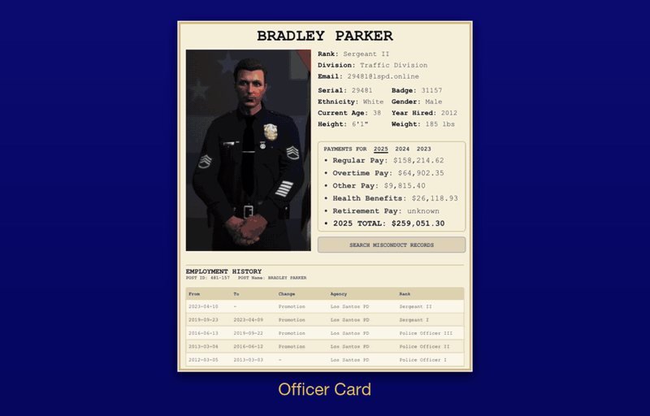

## Generators

<table>
  <tr>
    <td align="center" width="25%">
      <a href="https://damijjj.github.io/GUMA-tools/officer_generator.html">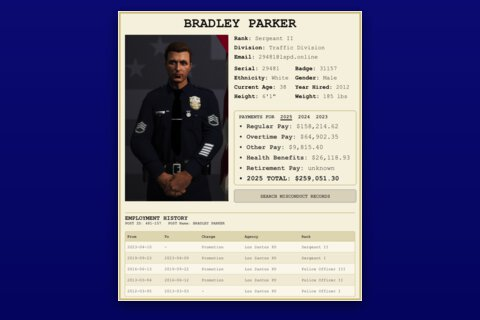</a> 
      <b><a href="https://damijjj.github.io/GUMA-tools/officer_generator.html">Officer Card</a></b> 
      LSPD / LSSD / BCSO / SAHP
    </td>
    <td align="center" width="25%">
      <a href="https://damijjj.github.io/GUMA-tools/firefighter_generator.html">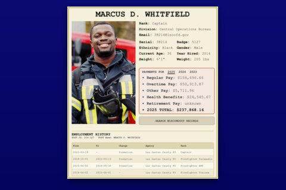</a> 
      <b><a href="https://damijjj.github.io/GUMA-tools/firefighter_generator.html">Firefighter Card</a></b> 
      LSFD / LSCoFD
    </td>
    <td align="center" width="25%">
      <a href="https://damijjj.github.io/GUMA-tools/business_card_generator.html">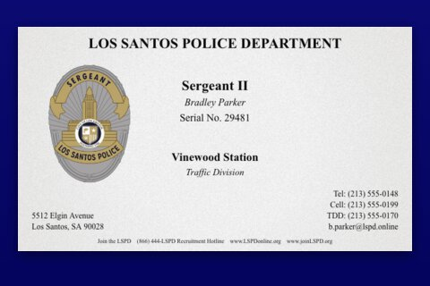</a> 
      <b><a href="https://damijjj.github.io/GUMA-tools/business_card_generator.html">Business Card</a></b> 
      LEA, fire or civilian
    </td>
    <td align="center" width="25%">
      <a href="https://damijjj.github.io/GUMA-tools/personnel_file_generator.html">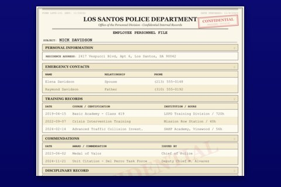</a> 
      <b><a href="https://damijjj.github.io/GUMA-tools/personnel_file_generator.html">Personnel File</a></b> 
      Confidential LEA record
    </td>
  </tr>
  <tr>
    <td align="center" width="25%">
      <a href="https://damijjj.github.io/GUMA-tools/arrest_report.html">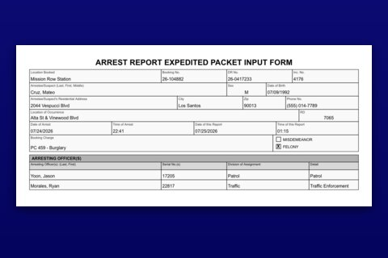</a> 
      <b><a href="https://damijjj.github.io/GUMA-tools/arrest_report.html">Arrest Report</a></b> 
      Arrest & booking
    </td>
    <td align="center" width="25%">
      <a href="https://damijjj.github.io/GUMA-tools/firearm_discharge.html">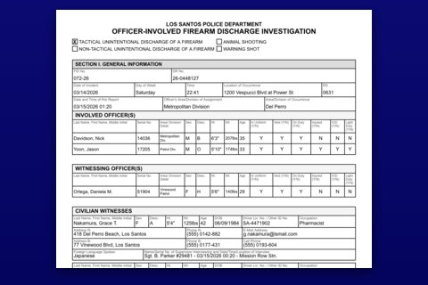</a> 
      <b><a href="https://damijjj.github.io/GUMA-tools/firearm_discharge.html">Firearm Discharge</a></b> 
      Officer-involved shooting
    </td>
    <td align="center" width="25%">
      <a href="https://damijjj.github.io/GUMA-tools/traffic_collision_report.html">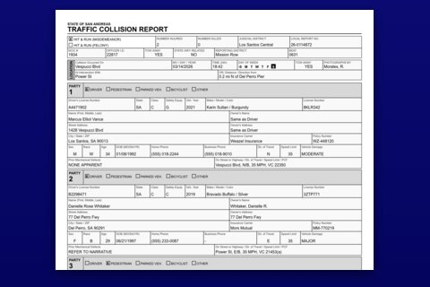</a> 
      <b><a href="https://damijjj.github.io/GUMA-tools/traffic_collision_report.html">Traffic Collision</a></b> 
      CHP 555-style
    </td>
    <td align="center" width="25%">
      <a href="https://damijjj.github.io/GUMA-tools/investigative_report.html">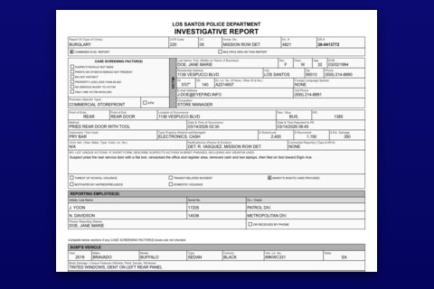</a> 
      <b><a href="https://damijjj.github.io/GUMA-tools/investigative_report.html">Investigative Report</a></b> 
      Crime, evidence & arrest
    </td>
  </tr>
  <tr>
    <td align="center" width="25%">
      <a href="https://damijjj.github.io/GUMA-tools/use_of_force_report.html">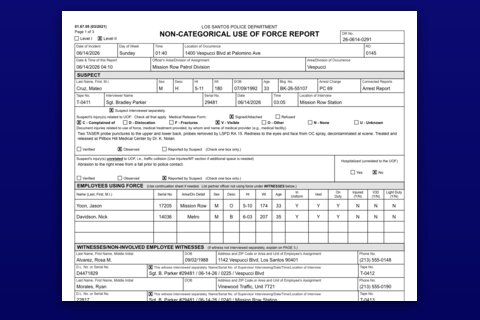</a> 
      <b><a href="https://damijjj.github.io/GUMA-tools/use_of_force_report.html">Use of Force</a></b> 
      With a body diagram
    </td>
    <td align="center" width="25%">
      <a href="https://damijjj.github.io/GUMA-tools/vehicle_pursuit_report.html">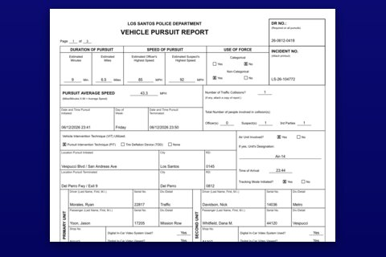</a> 
      <b><a href="https://damijjj.github.io/GUMA-tools/vehicle_pursuit_report.html">Vehicle Pursuit</a></b> 
      Full pursuit packet
    </td>
    <td align="center" width="25%">
      <a href="https://damijjj.github.io/GUMA-tools/probationary_evaluation.html">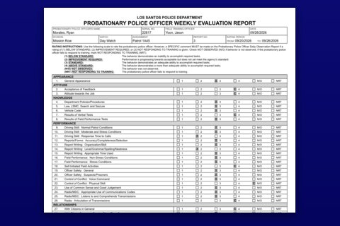</a> 
      <b><a href="https://damijjj.github.io/GUMA-tools/probationary_evaluation.html">Probationary Evaluation</a></b> 
      Weekly FTO rating
    </td>
    <td align="center" width="25%">
      <a href="https://damijjj.github.io/GUMA-tools/prehospital_care_report.html">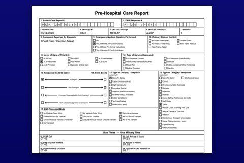</a> 
      <b><a href="https://damijjj.github.io/GUMA-tools/prehospital_care_report.html">Pre-Hospital Care</a></b> 
      EMS run sheet
    </td>
  </tr>
  <tr>
    <td align="center" width="25%">
      <a href="https://damijjj.github.io/GUMA-tools/fire_code_inspection_report.html">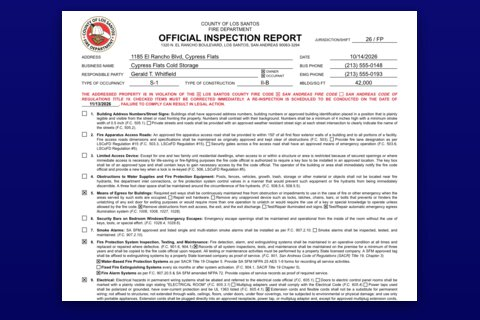</a> 
      <b><a href="https://damijjj.github.io/GUMA-tools/fire_code_inspection_report.html">Fire Code Inspection</a></b> 
      Violation checklist
    </td>
    <td align="center" width="25%">
      <a href="https://damijjj.github.io/GUMA-tools/wanted_poster.html">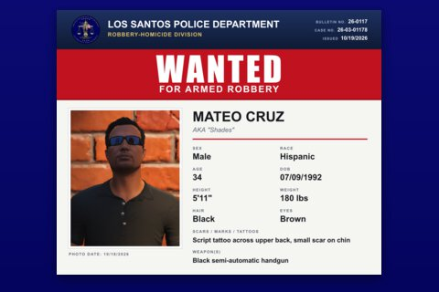</a> 
      <b><a href="https://damijjj.github.io/GUMA-tools/wanted_poster.html">Wanted Poster</a></b> 
      Wanted, BOLO, missing
    </td>
    <td align="center" width="25%">
      <a href="https://damijjj.github.io/GUMA-tools/bodycam_overlay.html">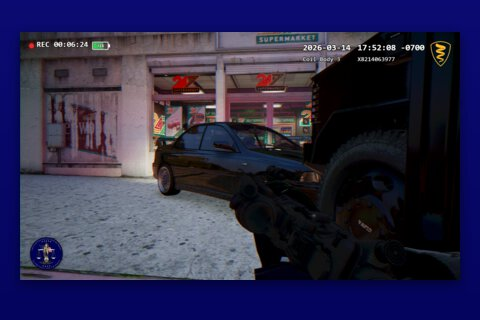</a> 
      <b><a href="https://damijjj.github.io/GUMA-tools/bodycam_overlay.html">Bodycam Overlay</a></b> 
      HUD on your screenshot
    </td>
    <td align="center" width="25%">
      <a href="https://damijjj.github.io/GUMA-tools/character_description.html">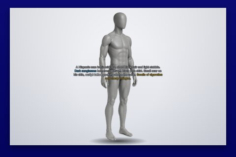</a> 
      <b><a href="https://damijjj.github.io/GUMA-tools/character_description.html">Character Description</a></b> 
      In-game /description
    </td>
  </tr>
</table>

## Highlights

- ✏️ **Edit on the document** - click a field on the rendered report and type
- 📤 **Export** - download as PNG or copy to clipboard
- 💾 **Saved documents & drafts** - kept in your browser, an unfinished form survives a reload
- 🎲 **Randomize** - one click fills in a random character
- 🌗 **Dark / light mode**, ⌨️ **Ctrl+K search**, 📱 installable as a **PWA**

## Run locally

No build step - open `index.html` in a browser or serve the folder from any static host.

## Credits

3D mannequin: _"Male base"_ by Arthur Migranoff, [poly.pizza](https://poly.pizza/m/eWGDnQ0jzmH), [CC BY 3.0](https://creativecommons.org/licenses/by/3.0/).

---

Built for FiveM roleplay. All agencies, names and badge numbers are fictional.

